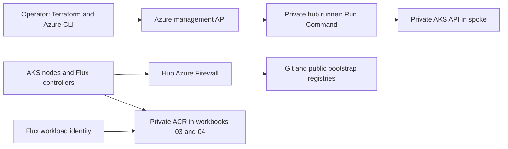

# Azure private AKS reliability workbooks

Ten disposable, cloud-deployable Terraform workbooks based on documented AKS,
Flux, Helm, networking, identity, and CRD failure patterns. Each workbook owns an
isolated Azure resource group and has separate `infra`, `bootstrap`, and `scenario`
Terraform roots. Deploy **one workbook at a time** unless you deliberately want
separate full Azure environments and their associated cost.

| Workbook | Controlled failure | Recovery |
| --- | --- | --- |
| [01 — private API DNS](workbooks/01-private-api-dns/README.md) | Remove only the hub's private API DNS link | Restore that link |
| [02 — hub egress](workbooks/02-hub-egress/README.md) | Deny GitHub HTTPS from the spoke firewall path | Remove the scoped deny |
| [03 — ACR private DNS](workbooks/03-acr-private-dns/README.md) | Keep registry login DNS but remove regional data DNS | Restore the data record |
| [04 — Flux Azure identity](workbooks/04-flux-azure-identity/README.md) | Remove Flux's registry-scoped pull role, keeping kubelet access | Restore the correct principal's role |
| [05 — Helm RBAC](workbooks/05-helm-rbac/README.md) | Ask a namespaced delivery account to install a ClusterRole | Split platform and tenant ownership |
| [06 — CRD ordering](workbooks/06-crd-ordering/README.md) | Reconcile a CR while its CRD producer is suspended | Restore producer and readiness dependency |
| [07 — CRD lifecycle](workbooks/07-crd-lifecycle/README.md) | Roll desired chart back while retaining an incompatible CRD | Apply a compatible schema and application |
| [08 — pending Helm operation](workbooks/08-helm-pending-operation/README.md) | Interrupt an actual Helm upgrade during a hook | Roll back to the recorded deployed revision |
| [09 — operator finalizers](workbooks/09-operator-finalizers/README.md) | Prune the cleanup operator before its CR completes deletion | Restore the controller and ordered cleanup |
| [10 — controller pressure](workbooks/10-controller-pressure/README.md) | Add bounded CRD/release load and constrain controller memory | Restore its resources and verify reconciliation |

Start with [deployment and cleanup](docs/deployment.md). Every workbook README
contains its own run sequence, diagnostic evidence, fix, pitfalls, and source.
Use the [incident record](docs/incident-record.md) to carry the exercise through
recovery, RCA, corrective work, verification, and retirement of temporary watches.

## Architecture and trust boundaries

AKS has no public API FQDN, local accounts are disabled, and the runner has no
public IP or inbound management rule. The operator uses Azure Run Command to
execute scoped actions on the runner. The runner's managed identity has **lab-only**
AKS bootstrap privileges; tenant and workload identities are separately tested.
Do not reuse this bootstrap identity or connect these networks to production.

The baseline firewall intentionally permits HTTP/HTTPS to arbitrary FQDNs from
the isolated lab, plus required DNS/time/tunnel transport. It is a functioning
teaching baseline, **not a production egress allowlist**. Workbook 02 inserts a
specific higher-priority deny without cutting off the hub management runner.

## Prerequisites and pinned tools

- An Azure subscription, enabled AKS/Compute/Network/ManagedIdentity/ACR resource
  providers, sufficient regional compute quota, and permissions to create the
  resources and lab-scoped role assignments. Contributor alone cannot create
  role assignments; use your approved RBAC administration path.
- Locally: Terraform 1.13.5, Azure CLI, Bash, Python 3, `jq`, `git`, and a public
  SSH key. Private key material is never supplied to Terraform.
- Runner tools: Flux **2.10.0**, Helm **4.3.1**, kubelogin **0.2.22**, Terraform
  **1.13.5**, and kubectl matching the selected AKS minor. Downloads have checksum
  verification. Azure CLI comes from Microsoft's Ubuntu package repository.
- Select a **regionally available GA AKS patch** supported by Flux 2.10.0:
  Kubernetes >=1.35.2, >=1.36.1, or >=1.37.0 within those three minors. Run
  `az aks get-versions --location eastus -o table`; copy a supported patch into
  the workbook's `terraform.tfvars`. Do not rely on an unspecified regional default.
- A public branch of this repository containing the fixtures. Until a PR is
  merged, set `LAB_REPOSITORY_REF` to that PR's branch for both setup and later actions.

## Costs, credentials, and persistence

Every lab creates **Azure Firewall Standard, a private AKS cluster, Linux runner,
node compute/disks, a public firewall IP, peering, and DNS**. Workbooks 03/04 also
create **ACR Premium and a private endpoint**. These are paid resources, not a
free/local emulator. Review current regional prices before applying. Stopping
AKS does not remove firewall, disk, registry, or IP charges. Use the documented
reverse-order destroy and verify the resource group and managed node group are gone.

Azure credentials use your local Azure CLI/approved Terraform authentication,
and managed identity on the runner. No static keys or registry admin passwords
are created. Nonsecret connection metadata crosses Run Command; kubeconfigs and
cached runtime tokens stay on the private runner. Terraform state and connection
files are ignored by Git and still require appropriate access controls. State
is local by default: infra state is on the operator machine; bootstrap/scenario
state is on the runner. Preserve these until cleanup. See the runbook before
using a shared backend or destroying the runner manually.

## Verification boundaries

CI validates all 30 Terraform roots, mocked Azure fault/repair plans, Helm charts,
fixture structure, shell syntax, and controller/orchestration tests **without
Azure credentials**. It does not provision Azure or certify every regional
combination. Azure end-to-end deployment has not been performed during authoring.
Runtime `verify-fault` and `verify-healthy` require actual observed evidence and
return failure when the condition has not been demonstrated.

The finalizer controller is real but uses a ConfigMap as an external-allocation
marker; it does not create a billable cloud object. The memory-pressure workbook
reproduces OOM/reconciliation failure with explicit limits; it does not claim the
historical memory regression remains in the pinned current controller.
